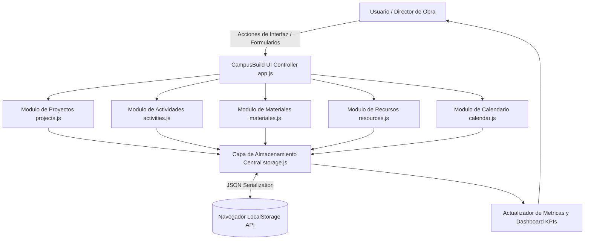

# CampusBuild - Sistema de Control y Gestion de Proyectos de Construccion

Plataforma web tipo Single Page Application (SPA) para la administracion integral de obras constructivas, control de inventario de materiales, cronogramas de actividades y asignacion de talento humano.

[]()
[]()
[]()
[]()
[]()

## Resumen Ejecutivo

La industria de la construccion demanda una coordinacion milimetrica entre cronogramas de obra, suministro de insumos criticos y disponibilidad de personal calificado. CampusBuild soluciona esta problematica operativa proveyendo un centro de control ligero, rapido y sin dependencias de infraestructura de backend compleja. Su almacenamiento local en el navegador permite una adopcion inmediata en campo o puestos de control de obra con conectividad limitada.

## Alcance y Objetivos de Negocio

- Registro y seguimiento de ciclo de vida de proyectos constructivos (Planificacion, En Curso, Pausado, Finalizado).
- Desglose de actividades operativas con responsables asignados, fechas limite y estados de cumplimiento.
- Gestion y consumo de inventario de materiales con alertas visuales de nivel critico de existencias.
- Calendario interactivo de hitos y plazos de entrega para directores y residentes de obra.
- Cuadro de mando (Dashboard) con indicadores cuantitativos y metricas de avance en tiempo real.

## Arquitectura del Sistema

CampusBuild esta disenado bajo un patron arquitectonico modular en JavaScript puro (Vanilla JS):
1. Capa de Persistencia y Acceso a Datos (`storage.js`):
   Encapsula las operaciones de lectura, escritura y serializacion sobre la API de `localStorage`.
2. Capa de Modelos y Controladores de Dominio (`projects.js`, `activities.js`, `materiales.js`, `resources.js`, `calendar.js`):
   Contiene las reglas de negocio, validaciones y calculo de estados de cada entidad.
3. Capa de Orquestacion y Enlace (`app.js`):
   Coordina la inicializacion, eventos de interfaz y actualizacion sincronizada de vistas.
4. Capa de Presentacion (`index.html`, `styles.css`):
   Estructura visual reactiva con retroalimentacion inmediata al usuario.

### Diagrama de Flujo Arquitectonico



### Estructura de Directorios

```text
PROYECTO-JS-DASHBOARD/
├── README.md                    # Documentacion tecnica integral
└── campusbuild/
    ├── css/
    │   └── styles.css           # Diseno visual, variables globales y grillas responsivas
    ├── html/
    │   └── index.html           # Documento principal y contenedor de vistas dinamicas
    └── js/
        ├── app.js               # Punto de entrada, inicializador y manejador global de eventos
        ├── storage.js           # Repositorio de persistencia y serializacion LocalStorage
        ├── projects.js          # Logica empresarial de creacion y estado de proyectos
        ├── activities.js        # Administracion de tareas, checklist y estados de ejecucion
        ├── materiales.js        # Control de insumos, entradas, salidas y alertas de stock
        ├── resources.js         # Gestion de personal operativo y contratistas
        └── calendar.js          # Renderizado de cronograma mensual y visualizacion de fechas
```

## Stack Tecnologico

El sistema esta concebido para maxima eficiencia de ejecucion, prescindiendo de compiladores o dependencias externas pesadas.

### Logica y Persistencia de Datos

-  Sintaxis moderna con modulos, promesas y funciones flecha.
-  Almacenamiento semi-permanente local con serializacion JSON.
-  Formato de intercambio de objetos de datos estructurados.

### Maquetacion y Diseno de Interfaz

-  Estructura semantica con soporte de modales y formularios validados.
-  Hojas de estilo estructuradas con CSS Grid y Flexbox adaptativo.
-  Tipografia tecnica y moderna para lectura clara de datos numericos.

### APIs Nativas del Navegador Web

- **DOM Manipulation API**: Renderizado dinamico reactivo de tablas, tarjetas y paneles.
- **Date and Time API**: Calculo de duraciones, vencimientos y coloreado condicional de tareas atrasadas.

## Requisitos Previos del Sistema

- Navegador web compatible con estandares ECMAScript 2015 (ES6) y Web Storage:
  - Google Chrome 80 o superior
  - Mozilla Firefox 75 o superior
  - Microsoft Edge 80 o superior
  - Safari 13 o superior
- No se requiere instalacion previa de Node.js o servidores de base de datos SQL.

### Estructura del Almacenamiento (Claves LocalStorage)

| Clave en LocalStorage | Tipo de Estructura | Descripcion |
| :--- | :--- | :--- |
| `cb_projects` | Array de Objetos | Registro consolidado de obras civiles y estados de ejecucion |
| `cb_activities` | Array de Objetos | Listado detallado de tareas con fechas y responsables |
| `cb_materials` | Array de Objetos | Catalogo de materiales, existencias actuales y umbrales minimos |
| `cb_resources` | Array de Objetos | Registro de empleados, oficios y asignaciones activas |

## Guia de Instalacion y Despliegue Local

1. Clonar el repositorio localmente:
```bash
git clone https://github.com/SantiSarmiento11/PROYECTO-JS-DASHBOARD.git
cd PROYECTO-JS-DASHBOARD
```

2. Ingresar a la carpeta de la aplicacion:
```bash
cd campusbuild
```

### Verificacion de Integridad de Modulos

Validar que los archivos JavaScript de dominio esten presentes:
```bash
ls -l js/
```
No se requieren comandos de construccion como `npm install` o `npm run build`.

### Ejecucion de la Aplicacion

Opcion A: Abrir directamente el archivo `campusbuild/html/index.html` en el navegador con doble clic.

Opcion B: Iniciar mediante un servidor HTTP local para evitar restricciones de politicas CORS de archivo local:
```bash
# Ejecutar desde la carpeta campusbuild:
python -m http.server 8000
```

Navegar a la direccion: `http://localhost:8000/html/index.html`

## Funcionamiento del Sistema

El ciclo operativo cubre todo el flujo de gestion de obra:
1. Inicializacion y comprobacion de claves de almacenamiento mediante `storage.js`. Si estan vacias, se precargan datos de demostracion.
2. Renderizado del Dashboard de inicio con calculo automatico de porcentaje global de avance.
3. Registro de nuevas obras mediante modal interactivo con validacion de campos requeridos.
4. Vinculacion de tareas especificas asociadas al proyecto en curso.
5. Modificacion de consumos de material con actualizacion dinamica del balance de inventario.

### Modulos Funcionales de la Interfaz

- **Panel de Proyectos**: Creacion, edicion de alcance, presupuesto estimado y cambio de estado.
- **Modulo de Actividades**: Kanban o lista de actividades con estado (Pendiente, En Progreso, Bloqueada, Terminada).
- **Control de Insumos**: Formulario de recepcion y despacho de materiales de obra (cemento, acero, arena, etc.).
- **Calendario Operativo**: Mapa mensual con indicadores visuales de hitos y fechas clave de entrega.
